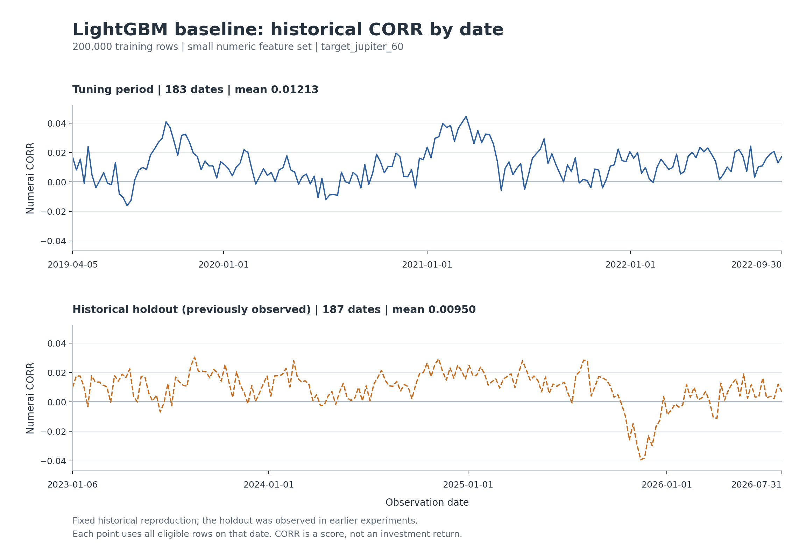
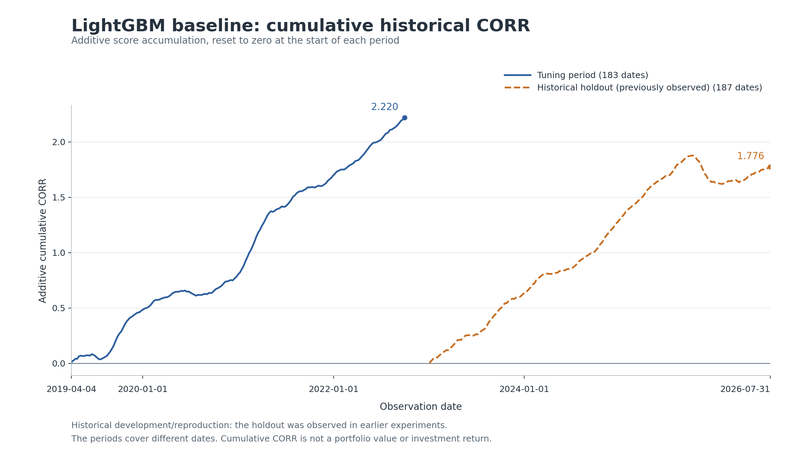

# XinchenGeng_1106baseline

Xinchen Geng's fixed LightGBM baseline and historical validation, using the latest completed data refresh available before November 7, 2026: Numerai v6.0 round **1392**.

`1106baseline` is the requested archive label. The actual run was completed on **November 5, 2026 in America/Los_Angeles**, or **November 6 UTC** (`2026-11-06T01:32:01.819298+00:00`). Original timestamps and source bytes remain in the evidence files. The November 7 round 1394 refresh is outside this archive.

## Fixed baseline and recorded results

The model is `B0_small_main`, with 100 small numeric features, `target_jupiter_60`, a fixed 200,000-row training sample and seed 7. LightGBM uses 300 trees, learning rate 0.05, maximum depth 5, 31 leaves and column sampling 0.1. Chronological preparation uses a 65-weekday embargo, giving 70 weekdays between retained boundaries. No validation-based tuning, early stopping, model selection or refitting is performed.

| Evaluation period | Date range | Dates | Rows | CORR mean | CORR std (ddof=0) | NCORR mean |
| --- | --- | ---: | ---: | ---: | ---: | ---: |
| Tuning period | 2019-04-05 to 2022-09-30 | 183 | 1,211,007 | 0.012133 | 0.011770 | 0.013674 |
| Historical holdout, previously observed | 2023-01-06 to 2026-07-31 | 187 | 1,261,556 | 0.009496 | 0.011769 | 0.010091 |

The refresh adds one scored date (July 31, 2026) and 7,149 predictions to the October 30 archive. All 369 common scored dates and 2,465,414 common predictions match exactly. One added date does not establish stable improvement. Historical holdout results include previously observed data and do not establish unseen-test or live performance. CORR and cumulative CORR are score diagnostics, not investment returns.

## Evidence

- [Summary metrics](results/xinchen_baseline_20261105_latest/metrics.csv) and [all 370 scored dates](results/xinchen_baseline_20261105_latest/per_date_metrics.csv).
- [Run and hashes](results/xinchen_baseline_20261105_latest/run.json), [frozen protocol](results/xinchen_baseline_20261105_latest/protocol.json), and [independent validation](results/xinchen_baseline_20261105_latest/validation.json). The recorded audit passed for 2,472,563 predictions; maximum CORR error was approximately `9.97e-17`.
- [Refresh validation](results/xinchen_baseline_20261105_latest/freshness_validation.json), [comparison with the old data](results/xinchen_baseline_20261105_latest/data_update_comparison.json), and [the added date](results/xinchen_baseline_20261105_latest/new_dates_metrics.csv).
- [Annual CORR](results/xinchen_baseline_20261105_latest/annual_corr.csv), [negative-score periods](results/xinchen_baseline_20261105_latest/failure_periods.csv), and [summary sources](results/xinchen_baseline_20261105_latest/analysis_sources.json).
- [Data provenance](results/xinchen_baseline_20261105_latest/data_provenance/) includes the original raw manifest, cleaning/split records, snapshot timestamps, and exact copied source snapshot. The top-level modeling scripts, references, requirements and proposal match that source snapshot byte for byte. The cleaning and scoring tests are preserved from the October 30 contribution.





## Reproduce the workflow

Start at the repository root. The recorded environment used Python 3.13.7. Public downloads need no account or API key and require approximately 8.27 GB plus space for processed data, model and predictions.

```powershell
cd XinchenGeng_1106baseline
python -m venv .venv
.\.venv\Scripts\python.exe -m pip install -r requirements.txt
.\.venv\Scripts\python.exe scripts/download_data.py
.\.venv\Scripts\python.exe scripts/prepare_data.py
.\.venv\Scripts\python.exe -m unittest discover -s tests -v
.\.venv\Scripts\python.exe scripts/run_xinchen_baseline.py --output results/xinchen_baseline_reproduction
.\.venv\Scripts\python.exe scripts/validate_xinchen_baseline.py --output results/xinchen_baseline_reproduction
.\.venv\Scripts\python.exe scripts/plot_xinchen_baseline.py --output results/xinchen_baseline_reproduction
.\.venv\Scripts\python.exe scripts/summarize_xinchen_baseline.py --output results/xinchen_baseline_reproduction
```

Use the same fresh output path throughout. The download script fetches currently available data; exact reproduction of round 1392 requires the matching archived data with hashes recorded in the provenance. Raw and processed datasets, trained models and row-level prediction Parquet files are generated locally and excluded from Git. Original audit records retain their original machine paths. A full audit requires the matching local model and predictions.
