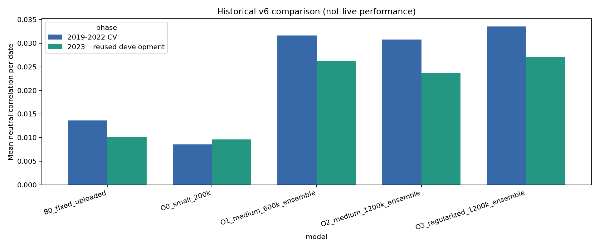
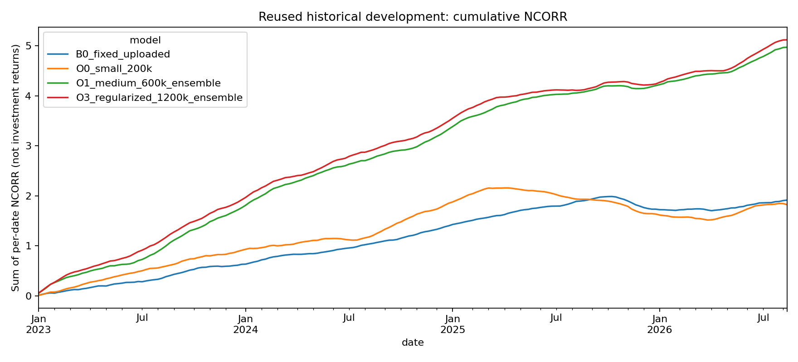

# Numerai v6 模型优化与提交交接

本轮 CV 入选 **O3：medium 120万正则化集成**，作为待 forward 验证的新候选。在 2023-01-06 至 2026-08-14 的已观察历史开发区间，平均 NCORR 从同协议 O1 的 0.026297 变为 **0.027082**，差值为 0.000785（相对变化 +2.99%）。

**平均分变化没有带来全面的稳定性改善。** NCORR mean/std 从 O1 的 1.601 变为 1.537，累计分数最大回撤从 0.057755 变为 0.069851；2025 年平均 NCORR 从 0.016718 变为 0.014238。稳定性指标没有优于 O1。相对 O1 的主配对差值区间包含零，当前历史证据不足以确认平均分优势。建议保留 O1 和固定 baseline 作为对照，在后续未参与选型的轮次继续检验，当前不能把这个挑战者称为已经全面胜出的替换方案。这些均为离线历史分数，不是未来 live 收益。

用户截图中的模型名为 `ZEXUGAO`，显示 **+3.4% Simulated**，CORR60 与 MMC60 均为空。截图没有提供足以诊断模型泛化的评分序列，模拟数值也不是本次训练或选型目标。`B0_fixed_uploaded` 是仓库中先前 baseline 的本地参照标识；未核实该文件是否对应截图账号或其模型。

## 本次改动与比较范围

数据使用独立快照 `snapshots/xinchen_20261116_round1399_latest`，版本 `v6.0`、目标 `target_jupiter_60`。研究池保留 6,983,088 条成熟记录，最近成熟日期为 2026-08-14。原 baseline、历史结果和既有提交均保留。

| 方案 | 每成员最多训练行 | 数值特征 | 模型种子 | 树数 | 学习率 | 列采样 |
| --- | --- | --- | --- | --- | --- | --- |
| O0：small 20万单模型 | 200,000 | 100 | 7 | 300 | 0.05 | 0.1 |
| O1：medium 60万三种子 | 600,000 | 350 | 7, 19, 43 | 300 | 0.05 | 0.1 |
| O2：medium 120万三种子 | 1,200,000 | 350 | 7, 19, 43 | 300 | 0.05 | 0.1 |
| O3：medium 120万正则化集成（CV入选） | 1,200,000 | 350 | 7, 19, 43 | 800 | 0.03 | 0.3 |

四个方案均按年度重训，每个年度只使用早于实际首个评分日期减去 65 个工作日的记录；工作日按 pandas BDay 的周一至周五定义。抽样先执行时间截断，再从同一个 seed 7 的最多 120 万行排列取前缀；O1 的 60 万行嵌套在 O2 的 120 万行中。三个成员分别在每个预测日期进行保留并列的百分位排名，再等权平均。

O0/O1/O2 使用 300 棵树、最大深度 5、31 个叶子。O3 同时改变树数、学习率、列采样、叶节点最小样本数 1000、L2 正则化 10 及 0.8 行采样，因此它检验的是一组联合配置。

**可归因的样本量对照：** O1 与 O2 的特征、模型种子、参数、时间切分和集成方法相同；开发期 NCORR 从 0.026297 变为 0.023649，差值为 -0.002648。固定 B0 不参与候选选择，其训练历史与重训频率也不同，与它的差值仅反映总体流程变化，不能全部归因于样本增加或集成。

## CV 选型

CV 覆盖 2019-04-05 至 2022-09-30，共 183 个日期、四个年度。固定选择规则为：逐日期等权平均 NCORR，减去四个年度平均 NCORR 的总体标准差的 0.5 倍；并列按候选编号排序。选择记录在本轮开发区间评分前冻结。CV 也已被项目开发使用，不能视为新的独立测试。

| 方案 | CV 平均 NCORR | 年度均值标准差 | 选择分数 |
| --- | --- | --- | --- |
| O0：small 20万单模型 | 0.008546 | 0.005378 | 0.005857 |
| O1：medium 60万三种子 | 0.031625 | 0.010631 | 0.026310 |
| O2：medium 120万三种子 | 0.030821 | 0.009529 | 0.026057 |
| O3：medium 120万正则化集成（CV入选） | 0.033555 | 0.009666 | 0.028722 |

冻结记录：[selection.json](<selection.json>)。2023 年起的结果继续标记为 `reused_development`，不会据此重新挑选方案。

## 两个历史区间的完整指标

mean/std 为非年化的逐日期均值除以总体标准差。最大回撤按从零开始的累计相关分数计算；它不是投资组合回撤或实际收益率。2019、2022、2026 的评分区间不是完整自然年。

### CV：2019-04-05—2022-09-30（183 个日期）

| 方案 | 指标 | 逐日期均值 | 总体标准差 | mean/std | 累计分数最大回撤 | 正分日期率 |
| --- | --- | --- | --- | --- | --- | --- |
| 固定 B0（本地参照） | CORR | 0.012133 | 0.011770 | 1.031 | 0.047275 | 85.8% |
| 固定 B0（本地参照） | NCORR | 0.013674 | 0.013305 | 1.028 | 0.073600 | 86.9% |
| O0：small 20万单模型 | CORR | 0.007753 | 0.014048 | 0.552 | 0.266078 | 71.6% |
| O0：small 20万单模型 | NCORR | 0.008546 | 0.014628 | 0.584 | 0.274825 | 73.2% |
| O1：medium 60万三种子 | CORR | 0.026970 | 0.017968 | 1.501 | 0.033096 | 92.9% |
| O1：medium 60万三种子 | NCORR | 0.031625 | 0.020978 | 1.508 | 0.019934 | 95.1% |
| O2：medium 120万三种子 | CORR | 0.025786 | 0.017376 | 1.484 | 0.058143 | 92.3% |
| O2：medium 120万三种子 | NCORR | 0.030821 | 0.020236 | 1.523 | 0.024849 | 94.0% |
| O3：medium 120万正则化集成（CV入选） | CORR | 0.029543 | 0.017623 | 1.676 | 0.019281 | 95.1% |
| O3：medium 120万正则化集成（CV入选） | NCORR | 0.033555 | 0.019460 | 1.724 | 0.006687 | 97.3% |

### 已观察开发：2023-01-06—2026-08-14（189 个日期）

| 方案 | 指标 | 逐日期均值 | 总体标准差 | mean/std | 累计分数最大回撤 | 正分日期率 |
| --- | --- | --- | --- | --- | --- | --- |
| 固定 B0（本地参照） | CORR | 0.009576 | 0.011736 | 0.816 | 0.257898 | 85.2% |
| 固定 B0（本地参照） | NCORR | 0.010132 | 0.012200 | 0.830 | 0.283831 | 86.2% |
| O0：small 20万单模型 | CORR | 0.007410 | 0.018417 | 0.402 | 0.742996 | 62.4% |
| O0：small 20万单模型 | NCORR | 0.009651 | 0.018360 | 0.526 | 0.641352 | 68.3% |
| O1：medium 60万三种子 | CORR | 0.021805 | 0.015065 | 1.447 | 0.061007 | 94.2% |
| O1：medium 60万三种子 | NCORR | 0.026297 | 0.016423 | 1.601 | 0.057755 | 97.4% |
| O2：medium 120万三种子 | CORR | 0.019116 | 0.015984 | 1.196 | 0.067028 | 86.2% |
| O2：medium 120万三种子 | NCORR | 0.023649 | 0.016532 | 1.431 | 0.058206 | 91.0% |
| O3：medium 120万正则化集成（CV入选） | CORR | 0.023547 | 0.016725 | 1.408 | 0.065608 | 91.0% |
| O3：medium 120万正则化集成（CV入选） | NCORR | 0.027082 | 0.017618 | 1.537 | 0.069851 | 94.2% |

数值来源：[汇总指标](<metrics.csv>)、[逐日期指标](<per_date_metrics.csv>)。





## 2025 年与新增成熟日期

2025 年实际覆盖 2025-01-03 至 2025-12-26。年度对照用于发现不同时期的表现差异；没有据此追溯调参，也不足以确定表现变化的市场原因。

| 方案 | 日期数 | 平均 CORR | 平均 NCORR | NCORR 正分日期率 |
| --- | --- | --- | --- | --- |
| 固定 B0（本地参照） | 52 | 0.006876 | 0.006390 | 78.8% |
| O0：small 20万单模型 | 52 | -0.005904 | -0.004169 | 28.8% |
| O1：medium 60万三种子 | 52 | 0.014093 | 0.016718 | 90.4% |
| O2：medium 120万三种子 | 52 | 0.008513 | 0.012270 | 78.8% |
| O3：medium 120万正则化集成（CV入选） | 52 | 0.011388 | 0.014238 | 82.7% |

以下是相对于旧研究池截止日 2026-07-24 新增的成熟日期，仍属于本项目已经可见的历史开发数据：

| 日期 | 记录数 | 入选 CORR | 入选 NCORR | O1 NCORR | 固定 B0 NCORR |
| --- | --- | --- | --- | --- | --- |
| 2026-07-31 | 7,149 | 0.025022 | 0.028567 | 0.019531 | 0.005182 |
| 2026-08-07 | 7,129 | 0.019074 | 0.020865 | 0.026229 | 0.017953 |
| 2026-08-14 | 7,119 | 0.006992 | 0.003113 | 0.005850 | 0.009936 |

入选模型在这 3 个日期的平均 NCORR 为 0.017515。观测日期很少且 60 日目标相互重叠，不能单独证明稳定优势。全方案明细见 [新增成熟日期](<newly_matured_dates.csv>)。

## 配对差值及其限制

下表在完全相同日期和股票总体上比较入选模型与各参照的 NCORR。使用 2,000 次圆形连续日期块 bootstrap；13 日期为主分析，26 日期为敏感性检查。

| 参照方案 | 平均 NCORR 差值 | 13 日期块 95% 区间 | 26 日期块 95% 区间 |
| --- | --- | --- | --- |
| 固定 B0（本地参照） | 0.016950 | [0.011563, 0.021742] | [0.010415, 0.022433] |
| O0：small 20万单模型 | 0.017431 | [0.011586, 0.022123] | [0.012304, 0.021999] |
| O1：medium 60万三种子 | 0.000785 | [-0.001258, 0.002827] | [-0.001499, 0.003055] |

这些区间仅描述已复用历史上的差值，未校正候选选择及此前的自适应开发。圆形块可能跨过年度重训边界并首尾相接，未建模结构变化；即使区间不含零，也不能称为经过选型校正的确认性显著性，更不能证明未来 live 胜出。完整结果与限定条件见 [配对比较记录](<paired_comparison.json>)。

## 最终训练与本轮 CSV

CV 入选配置已经单独重训。轮次 **1399** 的真实 live 数据日期为 **2026-11-13**；严格训练边界为 `2026-08-14`，要求日期 **小于** 该边界，因此排除边界当天，训练池最近日期为 **2026-08-07**。

完整可用训练池 6,975,969 行；每成员实际使用 **1,200,000** 行、**350** 个有序数值特征，模型种子为 **7, 19, 43**。本轮 CSV 包含 **7,106** 个唯一 ticker，6,296 个不同预测值；最后再对集成值进行保留并列的百分位排名。

下载：[优化模型本轮 CSV](<../../output/optimized_live_round1399/Optimized_live_round1399.csv>)；[最终模型 bundle](<final_model/O3_regularized_1200k_ensemble/bundle.json>)；[生成记录](<../../output/optimized_live_round1399/live_generation.json>)；[live 文件复核](<../../output/optimized_live_round1399/validation.json>)。

CSV SHA256：`7d6e433caaea594e8cdd79c3f6f7dde4231ddadb95a18b4d4e2b40065f7da791`。生成前后公开 API 的当前轮次一致，live 日期与该轮 dataDatestamp 一致。当前产物是待提交文件；生成流程没有上传账号、替换既有提交或执行质押。轮次及截止状态会变化，使用 CSV 前应再次确认适用轮次。

离线 NCORR 使用官方 neutralizer；它不是网站的 live MMC/NMMC。[validation_predictions.csv (inside handoff ZIP)](<../../../downloads/Numerai_optimized_model_round1399.zip>) 是本次评估日期的历史预测导出，覆盖 CV 的 183 个日期及开发期的 189 个日期，固定 embargo 间隔未预测。未验证官网是否接受这一日期子集，因此不将它称为可直接上传的完整 diagnostics 文件。本轮待提交 CSV 则完整覆盖实际 live 文件的 7,106 个 ticker。

## 验证与运行资源

训练、历史评分、图表与最终重训共耗时 **24.08 分钟**（1444.87 秒），Python 进程峰值工作集约 **8.82 GiB**，使用 12 线程。该范围不包含最初原始数据下载、独立复核和随后 live 公共文件下载。

独立历史复核覆盖全部 **372** 个日期、**2,486,811** 条保存预测记录、**20** 条汇总记录，并重算候选选择。全部模型的 CORR 经独立公式逐日期重算，最大绝对误差为 `4.23e-16`；NCORR 在每个年度分区抽查一个完整日期，共 8 个完整日期，最大误差为 `2.84e-16`。这不是第二遍重算所有日期的 NCORR。

live 复核从交接目录重新加载模型成员，核对文件哈希、特征顺序、ticker 覆盖与行序；CSV 数值通过精确往返检查，并用 scipy 的独立平均排名实现复核并列名次。模型重新加载的预测最大绝对误差为 `0`。

项目测试集 **90 项通过**，原始运行日志见 [tests.log](<tests.log>)。

历史独立复核范围以 [validation.json](<validation.json>) 为准；冻结方案、输入文件及源代码哈希见 [plan.json](<plan.json>) 和 [run.json](<run.json>)。这些检查验证计算与产物一致性，不证明新的 live 表现。

## 复现

从 `Project2` 目录执行。训练和 live 生成要求新的空输出目录；下面用 `_reproduction` 后缀保留本次材料。live 生成只接受运行时仍为当前轮次的 `--round`；轮次变化后应下载新 live 数据并按新日期重训。

```powershell
.\.venv\Scripts\python.exe scripts/run_model_optimization.py --data-root "snapshots/xinchen_20261116_round1399_latest" --baseline "results/xinchen_baseline_20261116_round1399_latest" --live-data "output/baseline_live_round1399/audit_data/live.parquet" --output "results/model_optimization_20261116_round1399_reproduction" --n-jobs 12
.\.venv\Scripts\python.exe scripts/validate_model_optimization.py --root "snapshots/xinchen_20261116_round1399_latest" --output "results/model_optimization_20261116_round1399_reproduction" --n-jobs 12
.\.venv\Scripts\python.exe -m unittest discover -s tests -v 2>&1 | Out-File -Encoding utf8 "results/model_optimization_20261116_round1399_reproduction/tests.log"
.\.venv\Scripts\python.exe scripts/generate_optimized_live.py --bundle "results/model_optimization_20261116_round1399_reproduction/final_model/O3_regularized_1200k_ensemble/bundle.json" --output "output/optimized_live_round1399_reproduction" --round 1399 --n-jobs 12
.\.venv\Scripts\python.exe scripts/build_model_optimization_report.py --output "results/model_optimization_20261116_round1399_reproduction" --live-output "output/optimized_live_round1399_reproduction"
```

后续每周只需对已经冻结的入选方案重训，无需重新搜索候选或反复回看开发分数。先取得该轮完整 live.parquet 与包含成熟标签的最新历史快照，再执行以下模板命令；将尖括号内文字替换为实际路径或日期，输出目录须为新的空目录。

```powershell
.\.venv\Scripts\python.exe scripts/refit_optimized_model.py --data-root "<最新快照>" --selection "results/model_optimization_20261116_round1399/selection.json" --live-data "<当轮完整live.parquet>" --output "results/optimized_refit_<新日期>" --n-jobs 12
```

该入口沿用冻结的 winner、样本量、特征和种子，并按新 live 日期重新执行严格的 65 工作日成熟隔离。重训后再用生成脚本读取新 bundle 产生对应轮次的 CSV。

官方口径：[Numerai v6 数据](https://docs.numer.ai/numerai-tournament/data)、[评分与诊断](https://docs.numer.ai/numerai-tournament/scoring)、[提交规则](https://docs.numer.ai/numerai-tournament/submissions)。

报告构建时间（UTC）：2026-11-17T02:08:44.740435+00:00。

> GitHub publication note: the 97 MB historical prediction CSV is provided inside the handoff ZIP rather than stored separately in Git. Its link above points to that ZIP, which also preserves the unmodified original report. Runtime receipts retain original absolute paths; supply CLI paths when using another machine.
